<h1 align="center"></h1>

<p align="center">
  <strong>Vérifiez votre CV, déclinez-le pour chaque offre, suivez vos candidatures.</strong><br>
  Gratuit, sans publicité, sans IA, auto-hébergé sur un simple hébergement mutualisé.
</p>

<p align="center">
  <a href="#installer-sur-un-hébergement">Installer</a> ·
  <a href="https://github.com/Hadr1en/cuvylo/releases/latest">Télécharger</a> ·
  <a href="#fonctionnalités">Fonctionnalités</a> ·
  <a href="docs/deploiement.md">Guide de déploiement</a> ·
  <a href="#licence">Licence</a>
</p>

<p align="center">
  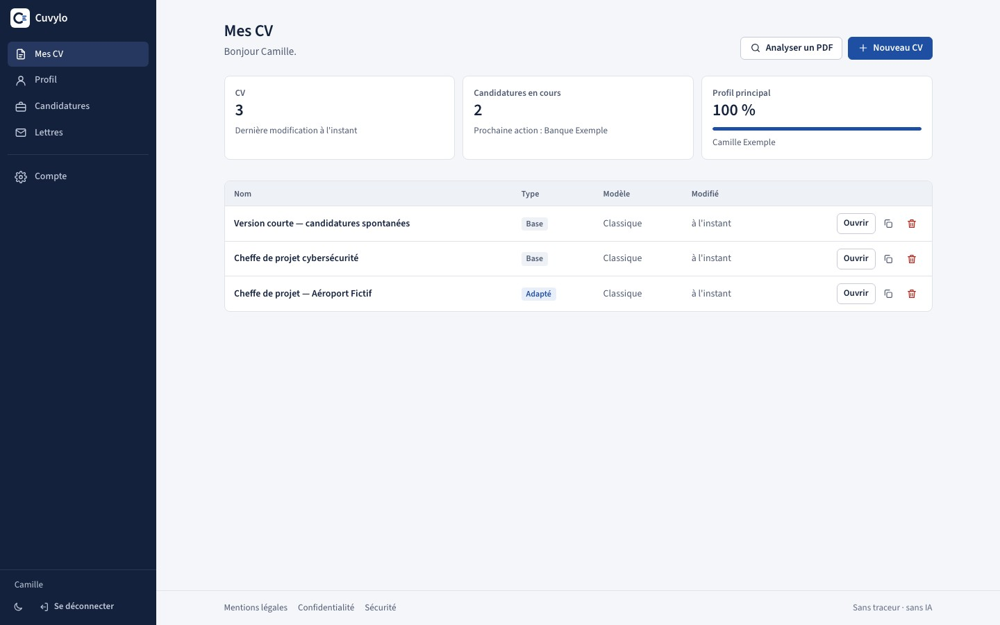
</p>

---

## Pourquoi Cuvylo

La plupart des candidatures passent d'abord par un logiciel de recrutement (ATS) qui extrait le texte du CV. Un CV soigné peut y devenir illisible : colonnes mélangées, coordonnées introuvables, rubriques non reconnues. Cuvylo montre **ce que ces logiciels lisent vraiment**, puis aide à écrire des CV qui passent ce filtre.

| | |
|---|---|
| **Vérifier un CV, sans compte** | La page d'accueil analyse n'importe quel CV PDF, fait avec n'importe quel outil, et le compare à une offre collée. Le fichier ne quitte pas votre navigateur. |
| **Créer ses CV** | Un profil unique, autant de CV que de postes, 18 modèles, un aperçu qui est le PDF exporté. |
| **Suivre ses candidatures** | Statut, CV envoyé, relances, lettres de motivation assorties au CV. |
| **Garder la main sur ses données** | Gratuit, sans publicité ni traceur ; l'adresse e-mail sert uniquement à se connecter. Vous l'installez chez vous : vos CV restent sur votre serveur. |

## Fonctionnalités

### Analyse ATS d'un CV existant, ouverte à tous

Déposez un PDF : Cuvylo affiche le nom, l'e-mail et le téléphone qu'il retrouve, les rubriques dans l'ordre de lecture, les caractères illisibles et **le texte exactement extrait**. Collez une offre : les mots-clés exigés et souhaités sont comparés à ce que le CV contient. Aucun compte, aucun envoi au serveur.

### Un profil, plusieurs CV

Vous saisissez votre parcours une fois : expériences avec **missions clients** (conseil, ESN, freelance), activités en parallèle, dates à l'année, compétences, formations, certifications, langues, projets, distinctions, publications, rubriques libres, photo facultative. Chaque CV en est une copie indépendante, que vous allégez ou adaptez. Import d'un export LinkedIn, d'un JSON Resume ou d'un PDF existant.

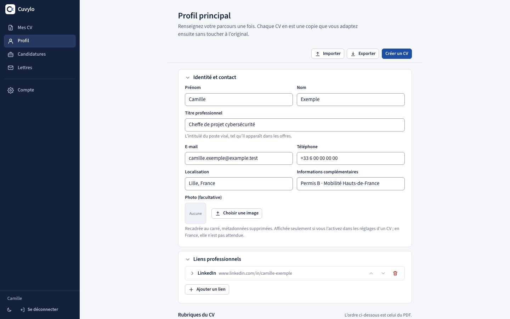

### L'éditeur : formulaire à gauche, PDF réel à droite

L'aperçu est le PDF réellement généré : texte sélectionnable, polices embarquées en latin étendu (Ł, ř, ș, ő…). Enregistrement automatique, sauts de page, expériences insécables, ajustement à 1 ou 2 pages, versions nommées avec **comparaison** et restauration, détection des modifications faites dans un autre onglet.

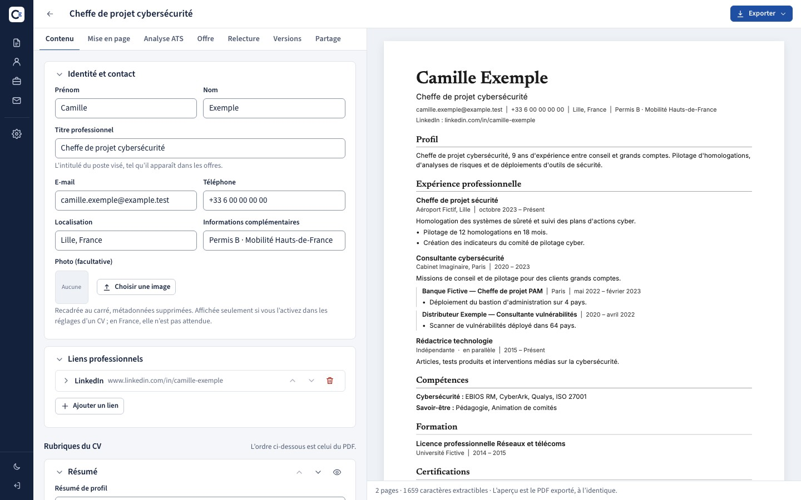

### Dix-huit modèles

Essentiels (Classique, Moderne, Compact, Encre), par métier (Consultant, Direction, Ingénierie, Médias, Académique, Européen), affirmés (Éditorial, Grille, Bandeau, Chronologie, Dossier), deux colonnes (Marge, Barre latérale) et Dossier de compétences. Couleur d'accent avec contrôle du contraste, paires typographiques, intitulés en anglais, anonymisation. Les modèles à deux colonnes sont signalés, et l'export propose alors un **PDF une colonne**.

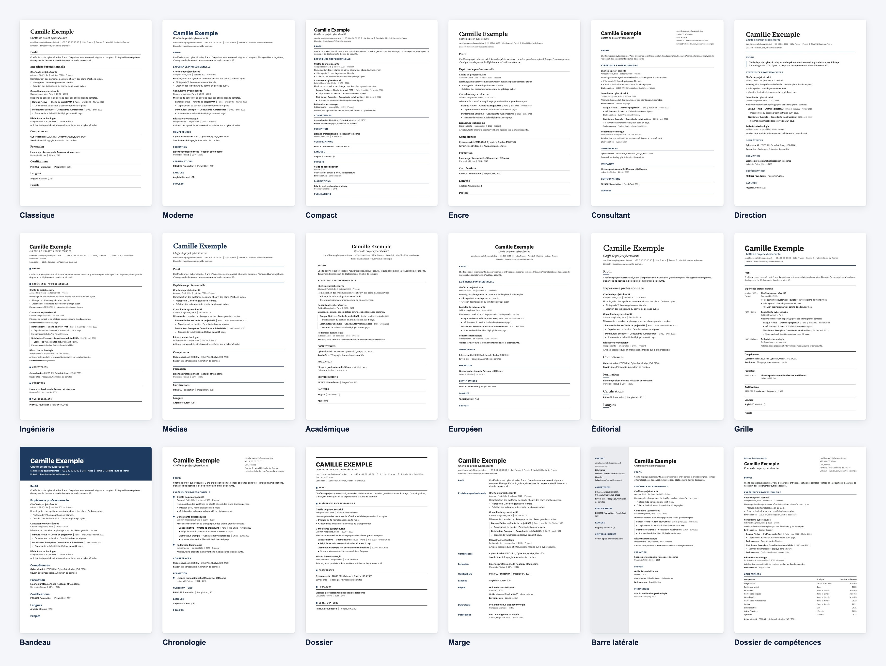

### Analyse ATS et relecture dans l'éditeur

Plus de 40 contrôles déterministes : rubriques essentielles, informations manquantes, cohérence des dates (missions et activités parallèles ne comptent jamais comme des chevauchements), caractères que les polices ne savent pas dessiner, texte extrait du PDF. La relecture signale les formulations faibles, la première personne, les temps mélangés, les mots vagues : elle explique, elle ne réécrit jamais.

<table>
  <tr>
    <td width="50%">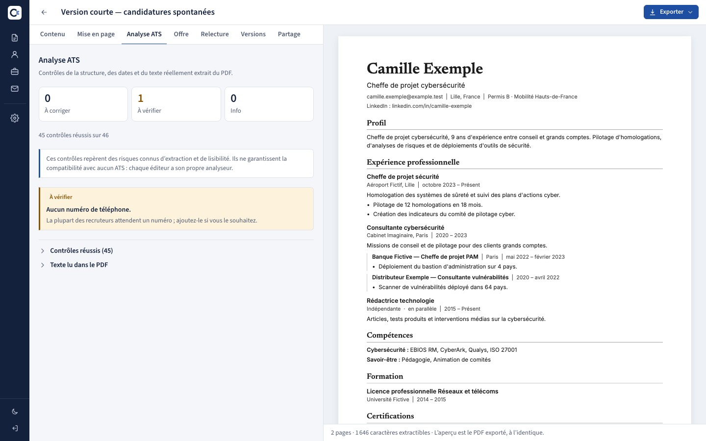</td>
    <td width="50%">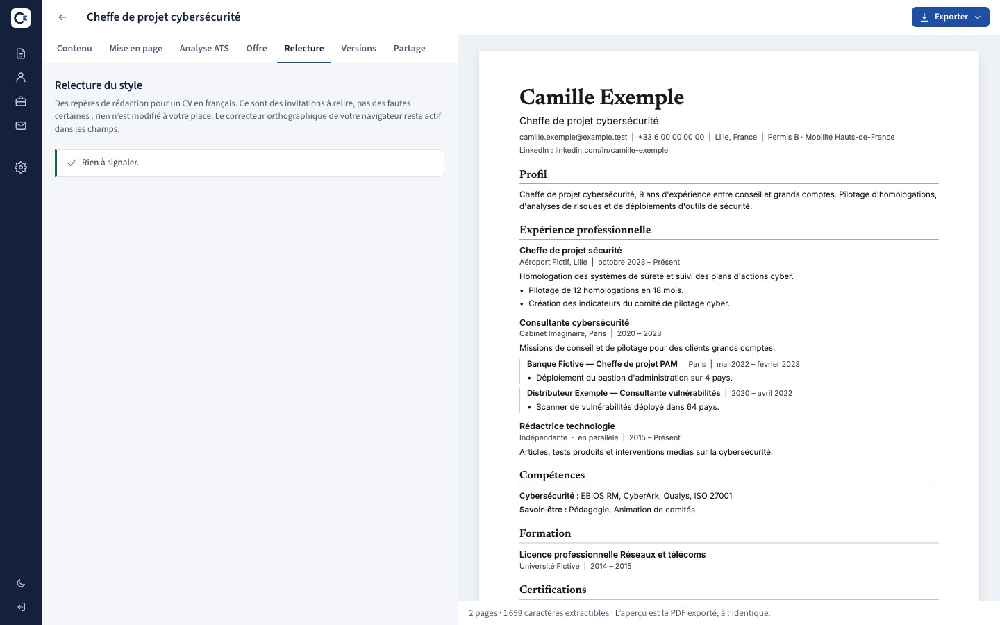</td>
  </tr>
</table>

### Comparaison à une offre

Les mots-clés de l'annonce (dictionnaire de termes, sigles et normes, alias comme ISO 27001 / ISO/IEC 27001) sont classés **exigés, souhaités, mentionnés**, puis cherchés dans le CV : présent, seulement dans les compétences, autre formulation, absent. Les pistes de reformulation n'inventent **jamais** une compétence. Un bouton crée une version adaptée du CV.

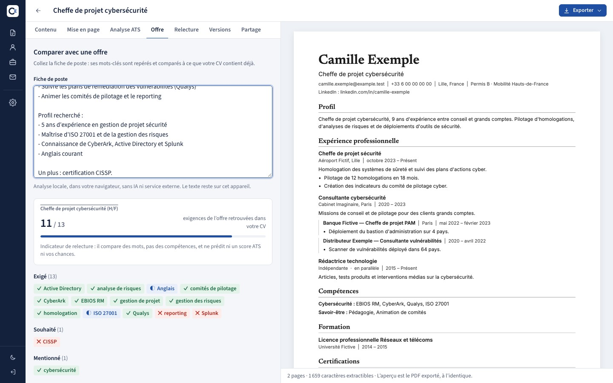

### Candidatures, lettres, partage, exports

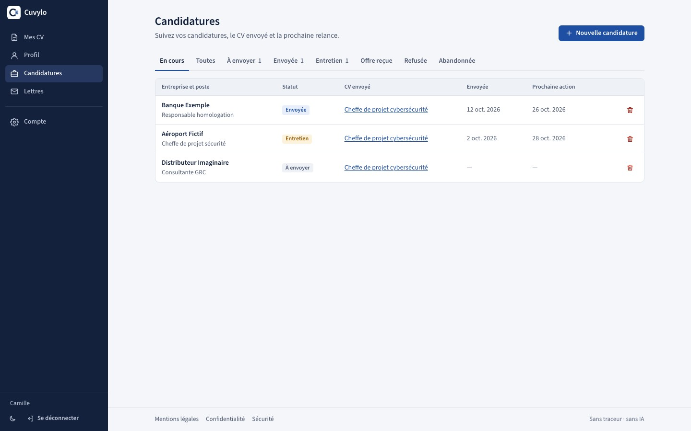

Lettres de motivation aux couleurs du CV associé ; partage d'un CV par lien (copie figée de ce que montre le PDF, anonymisable, expiration, révocation, QR code généré localement) ; exports PDF, PDF une colonne, Word, texte et JSON Resume.

### Compte et sécurité

Mot de passe oublié par e-mail (lien valable une heure, puis confirmation), double authentification (TOTP et codes de secours), sessions ouvertes, espace utilisé, export complet et suppression du compte.

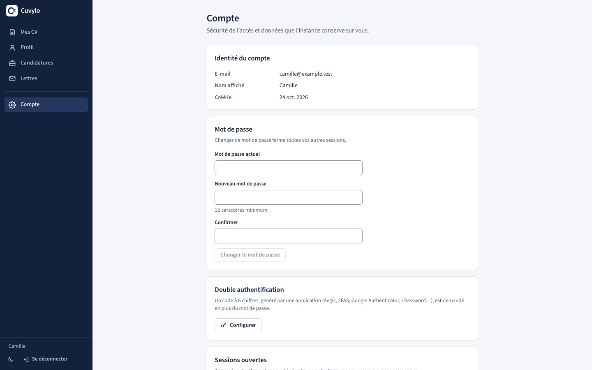

### Administration

Un interrupteur **Inscriptions ouvertes** (sinon, invitations nominatives à usage unique), la liste des comptes et l'espace utilisé, la déconnexion et la suppression d'un compte. L'administrateur ne voit **jamais** le contenu des CV et ne télécharge pas la base depuis l'interface ; il ne peut générer un lien de réinitialisation que si la personne l'a demandé.

### Clair, sombre, mobile

<table>
  <tr>
    <td width="60%">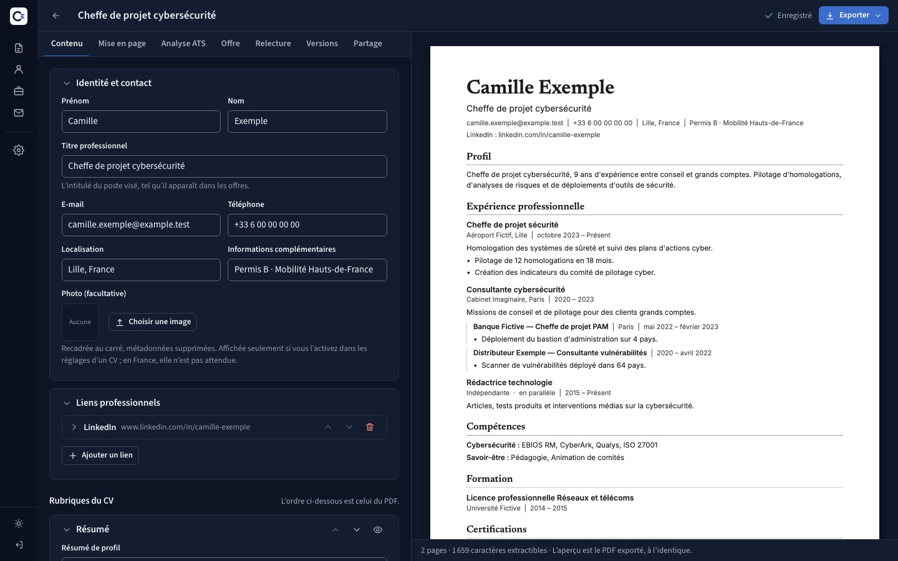</td>
    <td width="20%">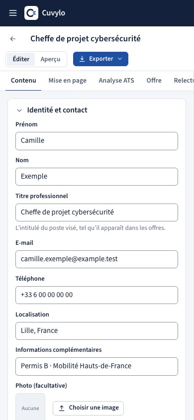</td>
    <td width="20%">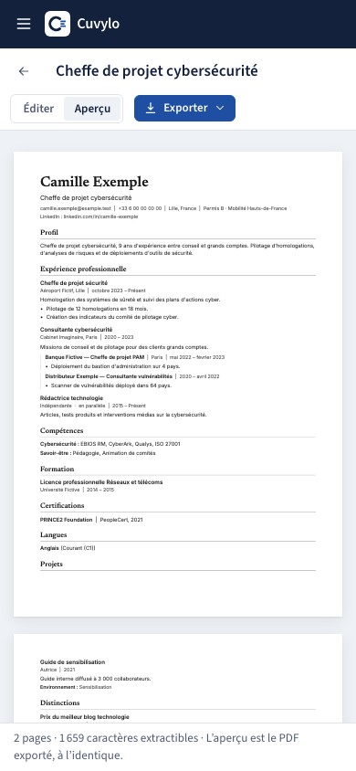</td>
  </tr>
</table>

<sub>Captures réelles, générées automatiquement (`npm run screenshots`) sur un profil fictif : « Camille Exemple ».</sub>

## Honnêteté sur les ATS

Aucun outil ne peut garantir la compatibilité avec « tous » les ATS : chaque éditeur a son propre extracteur. Cuvylo **réduit les risques connus** (texte réel, rubriques standards, pas de tableaux ni d'icônes, export une colonne), **signale des risques sans jamais promettre** (ni note globale, ni « pourcentage de compatibilité ») et **ne triche pas** : la comparaison à une offre compare des mots, pas des compétences, et ne propose jamais d'ajouter ce que vous n'avez pas fait.

## Installer sur un hébergement

Il faut un hébergement mutualisé classique : **PHP 8.1 ou plus, une base MySQL, HTTPS et un accès FTP**. Ni SSH, ni Composer, ni Node, ni fichier à éditer.

1. Créez une base MySQL dans l'espace client de votre hébergeur.
2. Téléchargez `cuvylo-<version>.zip` sur la page **[Releases](https://github.com/Hadr1en/cuvylo/releases/latest)**. Envoyez par FTP le **contenu** de `www/` dans le dossier du site, et le dossier `cuvylo/` à côté.
3. Ouvrez le site : un **assistant d'installation**, comme celui de WordPress, vérifie l'hébergement, teste la base, crée les tables, votre compte administrateur et la configuration, puis vous connecte.

**Mise à jour :** remplacez les fichiers par ceux de la nouvelle version en gardant `cuvylo/.env` et `cuvylo/var/` ; la base se met à jour toute seule. Pas à pas, cas particuliers (pare-feu de l'hébergeur, certificat, dossier introuvable) et contrôles : [guide de déploiement](docs/deploiement.md).

## Confidentialité

- **Analyse sans compte** entièrement dans le navigateur : ni le PDF ni l'offre ne sont envoyés.
- **Comptes** : l'adresse e-mail sert uniquement à se connecter et à réinitialiser le mot de passe. Ni publicité, ni newsletter, ni traceur, ni revente.
- **Minimisation** : deux cookies strictement nécessaires, pas d'adresse IP conservée avec les sessions, journaux sans donnée personnelle.
- **Droits** : export complet en JSON et suppression définitive du compte, depuis l'application.
- **Pages légales intégrées** (mentions légales, confidentialité, sécurité), remplies à partir de la configuration de votre instance : vous en êtes l'éditeur et le responsable de traitement.

Mesures de sécurité et limites connues : [SECURITY.md](SECURITY.md). Repères généraux, pas un conseil juridique.

## Développer

Prérequis : Node ≥ 22, PHP ≥ 8.1 (`pdo_sqlite` ou `pdo_mysql`), Composer. Guide pas à pas : [docs/installation.md](docs/installation.md).

```bash
# API
composer install --working-dir=backend
cp .env.example backend/.env        # APP_KEY, DB_DSN (SQLite possible), APP_URL, SETUP_CODE : voir le guide
php -S 127.0.0.1:8080 backend/bin/dev-router.php   # le schéma s'applique à la première requête

# Interface (autre terminal)
cd frontend && npm ci && npm run dev    # http://localhost:5173 → création du compte administrateur au premier lancement
```

| Couche | Choix |
|---|---|
| Frontend | React 19, TypeScript strict, Vite, Tailwind CSS 4, Source Sans 3 auto-hébergée |
| PDF | `@react-pdf/renderer` (génération), `pdfjs-dist` (aperçu, miniatures, extraction, analyse) |
| Exports / imports | `docx` (Word), `fflate` (archive LinkedIn), JSON Resume, `uqr` (QR codes) |
| Backend | PHP ≥ 8.1, **aucune dépendance de production**, PDO et requêtes préparées exclusivement |
| Base | MySQL en production (InnoDB, utf8mb4) ; SQLite pour le développement et les tests |

```
cuvylo/
├─ frontend/    React + TypeScript + Vite (modèles PDF, ATS, offres, relecture, imports/exports)
├─ backend/     API PHP (installation, comptes, 2FA, profil, CV, partages, candidatures, lettres, admin) + migrations
├─ shared/      profils d'exemple FICTIFS, validés par les tests PHP et TypeScript
├─ scripts/     paquet d'installation, envoi FTPS
├─ docs/        déploiement, installation locale, API, tests de bout en bout, logo, captures
└─ .github/     CI, publication des versions, déploiement manuel
```

### Tests

| Commande | Contenu | Résultat |
|---|---|---|
| `cd frontend && npm test` | PDF des 18 modèles et texte extrait, règles ATS, offres, relecture, imports/exports, autosave, assistant d'installation, analyse sans compte, anonymisation identique au serveur, parcours | 469 tests |
| `cd frontend && npm run lint && npm run typecheck` | ESLint (accessibilité incluse), TypeScript strict | sans erreur |
| `cd backend && php vendor/bin/phpunit` | Installation, authentification, 2FA, CSRF, limitation, **autorisations (IDOR)**, partages (contenu public filtré et anonymisé), administration, e-mails, migrations, pare-feu des mutualisés | 326 tests, SQLite et MySQL |
| `cd frontend && npm run e2e` | Vrai navigateur, build de production, API PHP et MySQL réels | 21 scénarios ([détail](docs/tests-e2e.md)) |

La CI GitHub rejoue tout sur PHP 8.1 et 8.3, MySQL 5.7 et 8.0. Pousser un tag `vX.Y.Z` publie le zip d'installation sur la page Releases.

## Contribuer

Les contributions sont les bienvenues : forkez, travaillez sur une branche, ouvrez une pull request vers `main` (protégée : CI verte et relecture obligatoires). Mode d'emploi et règles du projet : [CONTRIBUTING.md](CONTRIBUTING.md). Une faille ? [Signalement privé](https://github.com/Hadr1en/cuvylo/security/advisories/new), jamais d'issue publique.

## Documentation

[Déploiement](docs/deploiement.md) · [Sécurité](SECURITY.md) · [Contribuer](CONTRIBUTING.md) · [Changements](CHANGELOG.md) · [Installation locale](docs/installation.md) · [Tests de bout en bout](docs/tests-e2e.md)

## Licence

Cuvylo est distribué sous la **[PolyForm Noncommercial License 1.0.0](LICENSE.md)** : vous pouvez l'installer, l'utiliser, le modifier et le redistribuer **gratuitement, à des fins non commerciales** (usage personnel, associations, enseignement, recherche, administrations). Toute utilisation commerciale (vente, service payant, usage en entreprise) est exclue sans accord de l'auteur. Ce n'est donc pas une licence « open source » au sens de l'OSI, mais un code ouvert et réutilisable hors commerce.

Résumé en français, mention de copyright et licences des composants tiers (polices SIL OFL, bibliothèques MIT et Apache 2.0) : [NOTICE.md](NOTICE.md).
